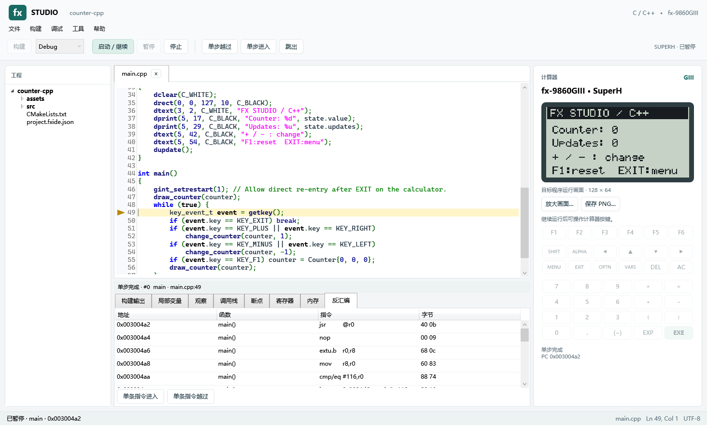

# Fx Studio

A Windows C/C++ IDE and offline SDK for the Casio fx-9860GIII, with SuperH machine-code emulation, GDB debugging, and a local MCP automation server. 中文 / English UI.

面向 fx-9860GIII 的 Windows C/C++ 开发环境：离线编译、计算器屏幕与按键预览、源码调试，以及供 LLM 和脚本使用的本地自动化接口。

**[Download / 下载完整离线包](https://github.com/lilith-is-all-you-need/fx-9860giii-sdk/releases/latest)** · [中文说明](docs/USER-GUIDE.zh-CN.html) · [English guide](docs/USER-GUIDE.en.html) · [Automation / MCP](docs/AUTOMATION.md) · [Build from source](docs/BUILDING.md)

## 使用 / Getting started

The `v0.2.0-r1` packaging revision fixes Windows IDE startup by preserving the desktop `WindowsBase.dll` when the application and console agent share a portable directory. Use the current release assets and checksums.

1. 在 Releases 下载 `FxStudio-0.2.0-win-x64.zip`，完整解压后运行 `FxStudio.exe`。需要 Windows 10 x64 1903 或更新版本；已验证系统为 Windows 10 22H2。无需安装 .NET、WSL 或在线恢复依赖。
2. 打开随包的 `examples/counter-c` 或 `examples/counter-cpp`，编译并启动调试。包内 HTML 文档可直接用浏览器阅读。
3. 编译输出 `.g1a` 用于计算器；配套未剥离 `.elf` 用于源码调试。SDK 本身运行在电脑上。

Download the complete Windows archive from Releases, extract it, and run `FxStudio.exe`. Open a bundled example, build, and start debugging. Normal calculator development works offline. GitHub's automatically generated **Source code** ZIP is a source checkout, not the offline application bundle.

### AI / Skill 接入

有本地文件和命令执行能力的 AI 可以使用 [fxstudio skill](skills/fxstudio/SKILL.md)，
无需手动配置 MCP，也无需打开 IDE。安装 Release 附件 `FxStudio-skill-1.0.0.zip`
或复制仓库的 `skills/fxstudio`，再提供完整 SDK 的解压路径。
见 [中文快速入门](skills/fxstudio/references/quickstart.zh-CN.md)：自动定位 SDK、持续调试会话、
编译/按键/截图、退出清理及并发隔离。单独安装 skill 不包含编译器或赋予本地执行权限。

## 功能 / Features

Loader Suite 的当前源码和本地集成包增加了目录式程序包、FX Profile Studio 0.2、
动态扩展页表及研究资料。旧版 Release 附件不会因为本页更新而自动获得这些功能。
Current Loader Suite sources and integration builds add the following features;
older release archives retain their original feature set.

| Area | Capabilities and scope |
| --- | --- |
| IDE | WPF/AvalonEdit editor, Chinese/English UI, CMake projects, Debug/Release builds, diagnostics |
| Toolchain | Native Windows GCC 14.1, binutils 2.42, fxSDK/gint 2.11, fxlibc, OpenLibm, C++ runtime |
| Debugging | GDB 16.3, source breakpoints, conditions, watchpoints, stepping, stack, variables, registers, memory, disassembly |
| Preview | Execution of actual SuperH G1A instructions, 128×64 calculator screen, keys, integer zoom and PNG capture |
| Resources | fxconv conversion through CMake, source-image preview with dimensions/transparency |
| Automation | `FxStudio.Agent.exe --stdio`: four stable MCP entry points, versioned domain commands, operations, events and snapshots |
| Profile Studio | Native WinUI 3, Chinese/English switching, batch input, stable name + short SHA folders, dependencies-only default, optional or independent Loader export |
| Ordinary Loader | Shared `FlashLd.g1a` scans `FXAPPS` folders; monochrome icon list; complete immutable images; full verification or explicit cached Fast mode |
| Large-program runtime | Source C/C++ integration and `ExtLoad.g1a`; profile-sized resident table, unused entries invalid, runtime storage/RAM bounds; no fixed 699-page requirement |
| Binary analysis | Offline Ghidra, references, original instruction bytes, exception/VBR ownership sites and review obligations; analysis does not automatically authorize patches |
| Calculator knowledge | Searchable embedded syscall coverage and evidence levels; separate Chinese/English developer and pitfalls manuals |
| Caller-session library | Cooperative business-state transactions and two MENU policies; current Flash launcher has no general caller-return backend and is rejected by capability checks |

详见 [Loader 套件中文手册](docs/LOADER-SUITE.zh-CN.md)、
[English Loader guide](docs/LOADER-SUITE.en.md) 和
[SDK 开发/踩坑手册](docs/loader/handbook/DEVELOPER-GUIDE.zh-CN.txt)。
普通 G1A 不需要程序名单，但不能保证所有程序；未知超限二进制仍需运行库适配。
The ordinary backend has no program whitelist. Arbitrary binary compatibility,
universal SH3 adaptation and full caller-state restoration are not guaranteed.

详细支持范围见 [SDK 能力说明](docs/SDK-CAPABILITIES.zh-CN.html) 和 [验证报告](docs/VALIDATION.html)。另外已用原始 `Wolfenst.g1a` 和 `Fruitnin.g1a` 验证基本游戏交互，见 [兼容性记录](docs/COMPATIBILITY.md)。

## 边界 / Limits

- The emulator implements a subset of Casio OS calls and hardware behavior; it is not a complete OS or cycle-accurate hardware replacement. No Casio ROM or proprietary SDK is distributed.
- Selected Loader probes and the two CAS first-launch paths have user-returned fx-9860GIII evidence. The complete SDK and the new folder/dynamic-runtime builds are not hardware-certified; prior CAS MENU re-entry failed. Emulator success does not establish stability.
- Source debugging requires a matching ELF with symbols. Optimized SDK library internals have more limited source visibility.
- C++ exceptions/threads, full USB/serial behavior, reverse debugging, automatic resource compression and a complete converted-resource preview are not included.
- The native release uses no WSL. Historical WSL provisioning scripts remain optional development material and do not constitute a finished offline rootfs.

## 项目结构 / Repository

| Path | Purpose |
| --- | --- |
| `src/FxStudio.App` | Desktop IDE |
| `src/FxStudio.Core` | Build service, GDB/MI, emulator and artifact verification |
| `src/FxStudio.Automation`, `src/FxStudio.Agent` | Versioned domain API and MCP stdio host |
| `examples`, `sdk/examples` | C/C++ calculator source examples |
| `tests`, `probes/emulator` | Contract tests, machine-code integration probes and emulator bridge |
| `third_party/emuCasioCalc` | Pinned upstream Git submodule; local debugger changes live in the bridge directory |
| `tooling` | Build, validation and packaging scripts |
| `desktop/ProfileStudio`, `sdk/caller-session`, `sdk/fxlarge` | Desktop preparation, cooperative caller contracts and source-integrated large runtime |
| `docs`, `source-notices` | User/developer documentation and source/license inventories |

Clone with `git clone --recurse-submodules https://github.com/lilith-is-all-you-need/fx-9860giii-sdk.git`. Read [BUILDING.md](docs/BUILDING.md) before rebuilding; the Git checkout does not contain large compiler binaries or dependency source archives.

## License

Original Fx Studio code is [MIT licensed](LICENSE). Dependencies retain their own licenses; see [THIRD-PARTY-NOTICES.txt](THIRD-PARTY-NOTICES.txt) and [source-notices](source-notices/README.md). Releases include the matching corresponding-source companion, dependency notices and SHA-256 checksums. Fx Studio is an independent project and is not an official Casio product.
