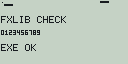
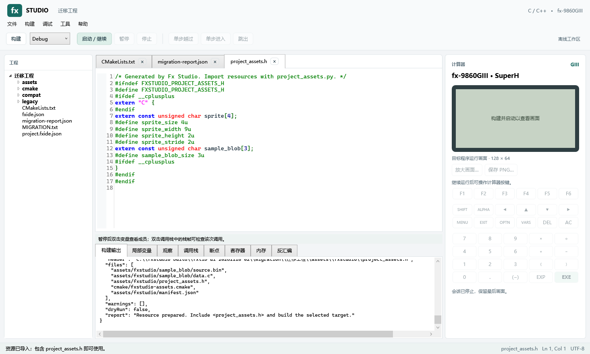

# fxlib 兼容层、资源导入与一致性验证

2026-11-18，Windows x64。本页保留兼容库分支 `e71a460` 在合并 Loader Suite 0.2
（`6e8afb1`）之前的实测结果，不改写历史 0.2.0 的验收，也不把旧测试算作合并后复验。
机器可读的结果、源文件与二进制 SHA-256 见 [validation-compat-20261118.json](validation-compat-20261118.json)。

## 合并前实际完成

| 检查 | 结果与范围 |
| --- | --- |
| .NET 重新构建 | 0 错误、0 警告；当前源码 Core 65 项、Automation 合约 129 项通过 |
| 合并发布目录启动 | 真实 WPF 渲染成功，Agent 发现成功；桌面 WindowsBase 版本匹配 |
| 公共兼容库 | 4 组测试通过；执行真实 C 核心及 gint 后端替身，检查绘图、键码、超时、多定时器与文件 world-switch |
| 旧工程迁移 | 8 项通过，包含旧 C 和 C++ 的 AddIn_main 工程分别真实编译链接 G1A |
| 资源导入 | 15 项通过，包含 C/CXX 工程的 bitmap/image/binary/font 四类资源实际 fxconv 转换和链接 |
| 文件完整性 | 覆盖重复导入、CRLF、符号冲突、保留外部编辑、路径拒绝、明确拒绝动态 CMake 目标 |
| 打包闭包 | 8 项通过；在独立测试包中真正执行默认 Flash 准备路径，检查转换器/启动器与哈希 |
| 工程脚手架 | 6 项通过；skill 模板 13 文件一致；fxlib 示例副本一致 |
| Loader 组件来源 | 合并前锁：3 组件、191 次文件哈希检查一致；这是旧锁记录，不是新目录套件的清单规模 |
| 模拟器重建 | 从当前源码独立重建，原 CPU 回归通过；Python 66 项通过、9 项需要私有固件而跳过；164 个 syscall 入口审计一致 |
| IDE 导入工作流 | 中文、英文各 7 项通过：创建迁移工程、原文件保留、图片导入、声明打开、编辑器刷新、取消等待事务、只读工程禁用 |

最后一项执行实际 WPF 方法和 Python 工具，并检查生成项目；系统文件选择对话框未逐一做鼠标自动化。
源码收集器的公开文件计划检查通过；未将私有游戏、固件或原官方 SDK 头文件装入公共源码。

## 合并前实际 SuperH 运行

`tooling/test_fxlib_target.py` 使用新完整本地包的 Agent 发现接口，创建一个独立的旧式
`AddIn_main` 工程，导入四种资源，再实际构建和调试。检查发生在目标程序执行后，
没有向目标内存写入“通过”标志。

- 启动状态：`validation_bits=31`，绘图、导入位图、两个定时器、文件读写往返和资源数据五项全部通过。
- 同一运行中的两个协作定时器分别观察到 5 / 3 次回调；这是功能检查，不是实机精确时序验收。
- 发送 EXE 后观察到 `key_result=30004`、`key_count=1`，实际画面显示 `EXE OK`。
- Debug 与 Release 均生成经过 ELF/G1A 配对校验的产物；原工程字节保持不变。
- 本次自有会话和后台 host 已关闭；既有运行套件与其他会话未被停止。
- 自包含 `examples/legacy-fxlib` 另行实际编译成功，Debug G1A 为 35,660 字节。





## 本次发现并修复

目标编译暴露并修复了重复 FindGint、GINT_CALL 参数类型、字体头文件和纯 CXX 工程未
启用 C 的问题。联调又修复了将 `blob[1] == value` 误判为符号定义、漏检未初始化数组
与 C++ 关键字、静态假分支目标误识别，以及导入期间外部修改可能被覆盖的问题。
GUI 停止/关闭现在等待文件事务结束，避免强杀进程绕过回滚。

旧本地模拟器缓存曾仅有 160 个入口，而当前源码为 164；新的构建来源检查会拒绝
过时二进制及不完整清单。Loader 组装器漏 Flash 文件、源包漏组件源码的问题已修复，
两个组装器共用明确清单。普通发行组装还要求源码归档与最终源码一致。

## 复现

```powershell
python -m unittest discover -s tests -p test_fxlib_compat.py
python -m unittest discover -s tests -p test_package_components.py
$env:FXSTUDIO_TEST_NATIVE = '1'
python -m unittest discover -s tests -p test_legacy_project.py
python -m unittest discover -s tests -p test_project_assets.py
Remove-Item Env:\FXSTUDIO_TEST_NATIVE
python tooling/test_fxlib_target.py --package C:/FxStudioUpdated --output C:/fxstudio-build/compat-run-new
```

资源检查需要 Pillow；完整 SDK 自带 Python/Pillow。原生测试默认使用本机
`dist-toolchain/native-sdk`，也可设置 `FXSTUDIO_TEST_SDK`。主机 C 测试需要 gcc 或 clang。
输出目录必须新建。模拟器独立重建和完整发布前置条件见 [BUILDING](BUILDING.md)。

## 合并 Loader Suite 0.2 后的证据范围

合入 `6e8afb1` 增加目录包、动态运行库、调用者会话库和 Profile Studio 更新。
新锁清单为 3 个组件、345 次文件哈希检查（340 个不同路径）；这个数值只描述清单，
不表示本页已经复跑新锁、组装闭包、桌面入口或完整包验收。
Loader 分支自己的结果见 [Loader Suite 0.2 独立验证](loader/VALIDATION-0.2.md)。
本页上方的 WPF、Agent、二进制哈希、截图与测试计数继续归属于合并前运行；
合并后的检查应以新的产物身份另行记录，不能覆盖原证据或仅更改其标签。

## 尚未证明的能力

没有对新兼容库做实体计算器验收，没有验证所有 fxlib API、官方字体逐像素一致、
硬件中断定时等价或完整 MENU/退出生命周期。当前库有 57 个旧名接口，采用明确的
源码兼容子集；协作定时器、ASCII 字体、Fugue 文件系统等边界见支持矩阵。
旧发行 ZIP、历史 source companion 与本机热更新目录不能因为名称相同就当作本次产物。
本次 GitHub 同步的是源码和文档；未以这些局部验证替换原发行附件的完整发布验收。
