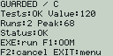

# 本次迁移与脚手架验证

记录日期：2026-11-15。这是新 Fx Studio 工程的实际结果，不是从旧 KhiCAS 的通过记录推导。

- 工程工具：6 组契约测试通过，覆盖新目录创建、拒绝覆盖、中文/空格/撇号路径、
  同长度修改、文件新增/删除、忽略会话凭据、空清单与越界路径拒绝、预算边界与余量、
  错误政策拒绝，以及实机记录保持未测试。
- 宿主 C：使用现有 MinGW GCC 编译同一套 arena/model contract，退出码0；
  包括两处分配失败、50次取消、50次成功、无效对齐、超大申请及保护字节。
- 目标：通过完整 Fx Studio 0.2.0 原生 SDK 的 Debug 与 Release 构建和 ELF/G1A 配对校验。
  Debug G1A 26,924 B；Release G1A **26,636 B**。
- 真实 SuperH 指令模拟器：7个场景通过；均在暂停后获取一致变量快照和新截图。
  正常计算、注入申请失败、失败后重试、取消、取消后重试、启动和模拟器重启符合预期。
- 源码身份：被编译的工程与当前 guarded-c 11份源码/配置/说明输入哈希一致。
- skill：结构校验通过；独立ZIP重新解压后可离线创建工程，13份模板文件哈希吻合。
  仓库版与本机安装版已同步，原连接 helper 未改动。

| 场景 | Value | Runs | scratch.used | last_status |
| --- | ---: | ---: | ---: | ---: |
| 启动 | 0 | 0 | 0 | 0（成功） |
| EXE | 120 | 1 | 0 | 0 |
| F1 内存失败 | 120 | 1 | 0 | 1 |
| 失败后 EXE | 120 | 2 | 0 | 0 |
| F2 取消 | 120 | 2 | 0 | 2 |
| 取消后 EXE | 120 | 3 | 0 | 0 |
| 模拟器 EXIT 重启 | 0 | 0 | 0 | 0 |

每个场景 selftest_failures 均为0。最后一项不是实机菜单或直接重入证明；
本次没有连接计算器，**hardwareTested=false**。未测试真实设备容量极限、物理代码缓存、
OS文件接口、任意长会话或速度对比。

机器可读摘要及产物/模板哈希见 [validation.json](validation.json)。
完整本机回放位于仓库 research/engineering-20261115/target-run-01，构建/调试输出未纳入 Git。
可复现命令见[脚手架操作手册](LIBRARIES-AND-SCAFFOLDS.zh-CN.md)。

## 同轮定位并修正的问题

首次 Python CLI 测试暴露了 Windows 重定向输出采用本地 ANSI 编码，而调用端按 UTF-8
读 JSON 的不匹配。现工程 helper 显式输出 UTF-8，包含中文及撇号路径的所有契约测试
重新通过。该问题属于本次新增工具，未改动原SDK的连接协议或编译器。

迁移时也发现新旧项目并非同级目录。来源现在按实际旧工作区读取，并记录原文哈希；
独立模板、skill和文档运行不依赖那个绝对路径。
